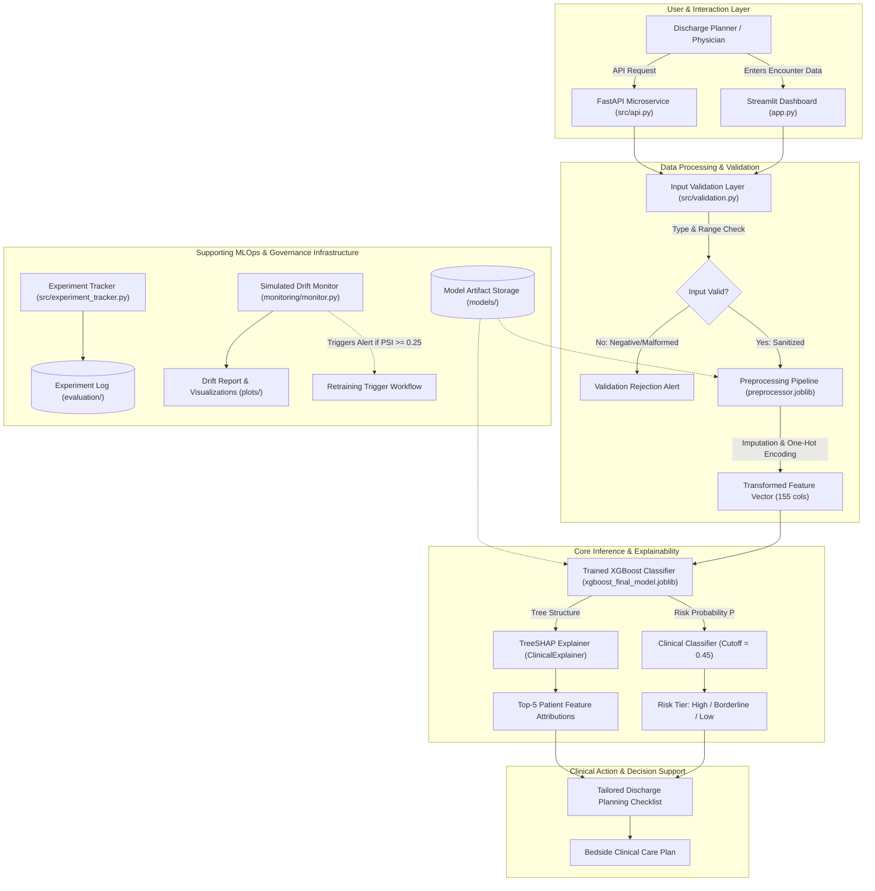

# GlucoShield CDSS — System Architecture & Technical Design

**FUSE AI-201 Capstone | Module 6: End-to-End System Architecture**  
**Group:** Group 04 (YEEAP Capstone)  
**Selected Primary Model:** XGBoost Classifier (`models/xgboost_final_model.joblib`)  
**Operating Decision Threshold:** 0.45 (Clinical Recall Priority >= 65%)  

---

## 1. High-Level Architectural Overview

GlucoShield is architected as an **AI-driven Clinical Decision Support System (CDSS)** designed to integrate seamlessly into hospital pre-discharge workflows. The system takes raw clinical parameters entered at discharge, validates and transforms them into standardized feature representations, infers 30-day readmission risk via a calibrated XGBoost ensemble, decomposes the prediction into patient-specific SHAP attributions, and outputs an actionable post-discharge care plan.

The system is augmented by supporting MLOps components for **artifact versioning, experiment tracking, data quality monitoring, and population drift detection**.

---

## 2. End-to-End Data and Inference Flow

```
+───────────────────────────────────────────────────────────────────────────────+
|                             CLINICAL INTERACTION                              |
+───────────────────────────────────────────────────────────────────────────────+
                                        │
                                        ▼
             ┌─────────────────────────────────────────────────────┐
             │ Patient / User (Discharge Planner / Physician)      │
             └──────────────────────────┬──────────────────────────┘
                                        │ (Enters clinical parameters)
                                        ▼
             ┌─────────────────────────────────────────────────────┐
             │ Streamlit Web Interface (app.py)                   │
             │   - Interactive clinical discharge form             │
             │   - 3 Pre-built demonstration scenarios             │
             │   - Visual risk tier indicators & badges            │
             └──────────────────────────┬──────────────────────────┘
                                        │ (Passes raw parameter dict)
                                        ▼
+───────────────────────────────────────────────────────────────────────────────+
|                           DATA SANITIZATION LAYER                             |
+───────────────────────────────────────────────────────────────────────────────+
                                        │
                                        ▼
             ┌─────────────────────────────────────────────────────┐
             │ Input Validation & Sanitization Engine             │
             │ (src/validation.py)                                 │
             │   - Numeric boundary verification (LOS, labs, meds) │
             │   - Missing value imputation assignment (NaN/None)  │
             │   - Out-of-range clinical warning generation        │
             │   - Rejection of invalid non-numeric/negative data  │
             └──────────────────────────┬──────────────────────────┘
                                        │ (Validated DataFrame)
                                        ▼
             ┌─────────────────────────────────────────────────────┐
             │ Preprocessing & Feature Engineering Pipeline        │
             │ (models/preprocessor.joblib / src/data_pipeline.py) │
             │   - Median numerical imputation & StandardScaling   │
             │   - ICD-9 diagnosis mapping (9 clinical organ groups)│
             │   - Categorical One-Hot Encoding (handle_unknown)   │
             │   - Composite derivation: total_prior_visits,       │
             │     procedure_intensity, meds_per_day, med titrations│
             └──────────────────────────┬──────────────────────────┘
                                        │ (Standardized 155-dim vector)
                                        ▼
+───────────────────────────────────────────────────────────────────────────────+
|                         CORE INFERENCE & EXPLAINABILITY                       |
+───────────────────────────────────────────────────────────────────────────────+
                                        │
                                        ▼
             ┌─────────────────────────────────────────────────────┐
             │ Trained Primary Classifier: XGBoost                 │
             │ (models/xgboost_final_model.joblib)                 │
             │   - Evaluates non-linear interactions & polypharmacy│
             │   - Calibrated scale_pos_weight = 10.14             │
             │   - Computes readmission risk probability P in [0,1]│
             └──────────────────────────┬──────────────────────────┘
                                        │
                    ┌───────────────────┴───────────────────┐
                    │                                       │
                    ▼ (Risk Probability P)                  ▼ (Transformed Vector)
  ┌───────────────────────────────────┐   ┌───────────────────────────────────┐
  │ Prediction & Risk Classification  │   │ TreeSHAP Local Feature Attribution│
  │ (src/validation.py)               │   │ (src/explainability.py)           │
  │   - Operating Cutoff: 0.45        │   │   - Decomposes log-odds impact    │
  │   - P >= 0.50: High Risk (Red)    │   │   - Top-5 patient-specific risk   │
  │   - 0.40 <= P < 0.50: Borderline  │   │     drivers & mitigating factors  │
  │   - P < 0.40: Low Risk (Green)    │   │   - Direction & absolute magnitude│
  └─────────────────┬─────────────────┘   └─────────────────┬─────────────────┘
                    │                                       │
                    └───────────────────┬───────────────────┘
                                        │
                                        ▼
             ┌─────────────────────────────────────────────────────┐
             │ Dynamic Discharge Planning Checklist                │
             │   - High Risk: Home nurse (48h), Med recon, 7d clinic│
             │   - Borderline: Medication regimen review, 14d check│
             │   - Low Risk: Standard diabetes education, 30d follow│
             └─────────────────────────────────────────────────────┘
```

---

## 3. Mermaid System Workflow Diagram



---

## 4. Component Implementation Status: Current vs. Proposed

To maintain academic and professional honesty, the components of GlucoShield are explicitly categorized into **Fully Implemented & Verified** versus **Proposed Future Enhancements**:

| Component | Status | Implementation Details |
| :--- | :---: | :--- |
| **Streamlit Clinical UI** | **Implemented** | Working prototype with preset demonstration scenarios, live score display, threshold banner, and SHAP table. |
| **Input Validation Engine** | **Implemented** | `src/validation.py` enforcing clinical bounds, missing imputation fallback, and format verification. |
| **Data Cleaning & Pipeline** | **Implemented** | `src/data_pipeline.py` with causal cohort deduplication, hospice exclusion, and 9-group ICD-9 mapping. |
| **XGBoost Primary Model** | **Implemented** | Calibrated gradient-boosted trees serialized in `models/xgboost_final_model.joblib` operating at 0.45 cutoff. |
| **SHAP Explainability** | **Implemented** | Real-time TreeSHAP local attribution in `src/explainability.py` providing top-5 risk drivers. |
| **Automated Testing Suite** | **Implemented** | 17 automated tests in `tests/` covering preprocessing, model loading, input validation, scenarios, and API. |
| **FastAPI REST Endpoint** | **Implemented** | `src/api.py` exposing `GET /health` and `POST /predict` with Pydantic request/response validation. |
| **Experiment Tracking** | **Implemented** | `src/experiment_tracker.py` logging runs, parameters, thresholds, and metrics to `evaluation/experiment_runs.json` and CSV. |
| **Drift & Quality Monitoring**| **Implemented** | `monitoring/monitor.py` & `drift_detector.py` calculating PSI and KS statistics on simulated production cohorts. |
| **Containerization** | **Implemented** | `Dockerfile` and `.dockerignore` for portable container deployment. |
| *Direct EHR HL7/FHIR Link* | *Proposed Future* | Direct API integration with hospital Electronic Health Record systems (Epic Systems / Cerner Millennium). |
| *Clinical NLP on Doctor Notes*| *Proposed Future* | BioClinicalBERT pipeline to parse unstructured nursing discharge summaries and social determinants of health. |
| *Longitudinal Trajectory Model*| *Proposed Future* | Recurrent/Transformer network modeling sequential patient readmissions over multiple successive hospital stays. |
| *Automated Online Retraining* | *Proposed Future* | Production pipeline executing scheduled retraining on newly reconciled 30-day clinical outcomes. |

---

## 5. Security and Data Flow Architecture

1. **Client Isolation:** Patient encounter queries submitted via the Streamlit UI or FastAPI endpoint are processed in-memory within the runtime session.
2. **Zero PHI Persistence:** No patient identifiers (names, MRNs, addresses) are captured or stored on server disks.
3. **Artifact Integrity:** Serialized model artifacts (`.joblib`) are stored in read-only directories and verified by automated checksums and unit tests.
4. **Resilience & Fallback:** Out-of-bounds parameters generate non-blocking clinical warnings; unrecognized categories fall back gracefully to imputed standard vectors without application crashing.

